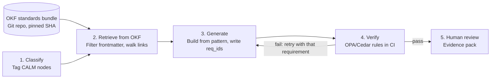

# OKF for Standards Retrieval in Architecture-as-Code

Oct 8, 2026 · George Seib

OKF gives agents a curated, linked, versioned map of standards they can navigate deterministically. For architecture-as-code, "retrieve similar text" becomes "walk from this component to every requirement that applies to it."

## The retrieval problem

An agent generating architecture-as-code (CALM, Terraform, policy bundles) needs the *applicable* standards, not the most *similar* paragraphs. Chunked RAG struggles with that, even when documents say what they apply to:

- **Ranking isn't completeness.** Top-k can drop a control that applies, and you can't tell a miss from "nothing applies."
- **Conditions don't combine.** A CMK rule for object stores *holding PII* ranks the same for a public assets bucket.
- **Status and precedence are invisible.** Superseded versions and division overrides look like current text.
- **No audit trail.** Reviewers need the requirement IDs the agent considered, and why.

## OKF in brief

The [Open Knowledge Format](https://cloud.google.com/blog/products/data-analytics/how-the-open-knowledge-format-can-improve-data-sharing) is an open spec Google Cloud published at v0.1 on June 12, 2026: a directory of Markdown files with YAML frontmatter that formalizes the "LLM wiki" pattern.

| Element | What the spec says | Why it matters here |
| --- | --- | --- |
| Frontmatter | Only `type` is required; producers add custom fields | Room for requirement IDs, severity, scope, status |
| Markdown links | Links between files form a traversable graph | Encode applies-to, satisfied-by, enforced-by, refines |
| `index.md` | Optional per-directory entry point | Domain summary before individual controls |
| Plain files | No SDK, runtime or account; lives in Git | Same repo, review and pinning as the architecture code |

Google's Knowledge Catalog ingests OKF natively, but any agent that reads files can consume a bundle ([spec and samples](https://github.com/GoogleCloudPlatform/knowledge-catalog)).

## Modeling standards as an OKF bundle

One bundle per standards layer (see Severity and layering), versioned in Git. `type` names the kind of knowledge atom.

```
standards/
├── index.md        # domains, precedence, how to navigate
├── vocab/          # closed lists: component classes, data classes…
├── policies/       # type: Policy
├── requirements/   # type: Requirement (one testable control each)
├── components/     # type: Component Class (mirrors CALM node types)
├── patterns/       # type: Pattern
├── rules/          # type: Enforcement Rule (OPA/Cedar check)
└── exceptions/     # type: Exception (scoped, expiring)
```

The spec mandates only `type`; the value comes from a few house fields with closed vocabularies:

```yaml
---
type: Requirement
title: Customer-managed keys for PII stores
req_id: DATA-ENC-007
scope: firm
severity: must            # must | should | may
status: active            # active | superseded | draft
supersedes: DATA-ENC-003
applies_to: [data-store]  # covers object-store via vocab
data_classes: [pii, confidential]
jurisdictions: [us, eu]
enforced_by: rules/kms-cmk-required.md
---
Any store holding PII must encrypt at rest with a customer-managed key.
Satisfied by [Encrypted object store](/patterns/encrypted-object-store.md).
Derived from [Data Protection Policy §4.2](/policies/data-protection.md).
```

Fields drive filtering, links drive traversal, and the body gives the rationale.

### Taxonomy: borrow, don't design

- **Reuse existing lists.** CALM node types, the firm's data classification policy, ISO region codes, and a control framework such as NIST 800-53 or FINOS Common Cloud Controls.
- **Keep it small.** About six fields, each a closed list in `vocab/`; CI rejects unknown values.
- **Model hierarchy once.** The vocab records that `object-store` is a kind of `data-store`; the retrieval tool expands queries, so files aren't double-tagged.
- **Agents draft, humans approve.** An agent proposes frontmatter citing the source sentence; reviewers fix it in a PR.
- **Let misses drive change.** Each control the filter missed is a wrong tag, a missing value or a missing field.

## Severity and layering

`severity` uses RFC 2119 levels, each with a defined behavior in the loop:

| Severity | Meaning | In the loop |
| --- | --- | --- |
| `must` | Required | A failing check blocks the build |
| `should` | Recommended | Warns; the agent writes a justification for the reviewer |
| `may` | Optional | Retrieved for context, never checked |

Firm, division and team standards live in separate bundles, each owned by its level (`standards-firm`, `standards-cib`, `standards-payments`). A team file declares `scope: team/payments` and `refines: firm/DATA-ENC-007`. Three rules keep the layers consistent:

1. **Lower levels only tighten.** They can raise `should` to `must` or add rules, never lower a `must`. CI checks each `refines` against its parent.
2. **Loosening is an exception approved upstream.** It links to the parent requirement, needs that owner's sign-off, and expires.
3. **Stricter wins** if a conflict slips through.

The agent loads the layers its CALM context names, each pinned to a commit, and returns a refining rule alongside its parent so the reviewer sees the lineage.

## Retrieval patterns OKF enables

Four deterministic moves, with semantic search as the fallback rather than the primary path:

| Pattern | How it works | What it fixes |
| --- | --- | --- |
| Index-first | Read root `index.md`, then the domain index, then files | Small context; the map before the detail |
| Frontmatter filter | Match `applies_to` (with vocab expansion), `data_classes`, jurisdiction, `status: active`, loaded layers | Applicability becomes a query; superseded text drops out |
| Link traversal | Follow satisfied-by, enforced-by and refines one or two hops | Brings the pattern and the check with the requirement |
| Semantic fallback | Embed bodies for questions the filters can't express | Catches the long tail |

Retrieval becomes **reproducible** (same metadata, same requirements) and **explainable** (cited `req_id`s and the edge that found each). A vector store with metadata filters can match the filtering; OKF adds the links, Git review and portability.

## Wiring it into the architecture-as-code loop

Retrieval moves to the front of the loop, and requirement IDs travel with the design to review.



A failing check points back to a specific OKF file, not a vague policy.

- **CALM as the join key.** Bundle component classes mirror CALM node types, so classification output is the filter input.
- **Policy-as-code as the proof.** Each `Requirement` links to the OPA or Cedar rule that proves it.
- **Expose it as a tool.** Wrap the filter-and-traverse logic as an MCP tool (`get_applicable_requirements(component)`) for any agent framework.
- **Human gate stays.** The reviewer approves against an evidence pack, not a raw diff.

## Worked example

Payments, in CIB, adds a statement-archive service: an API, a queue, and an object store holding customer PDFs in the US and EU.

1. **Classify.** CALM nodes `api-gateway`, `queue`, `object-store`, with `data_classes: [pii]` and `jurisdictions: [us, eu]`.
2. **Filter.** Across the firm, CIB and payments layers, `object-store` expands to `data-store` and matches DATA-ENC-007 (CMK), DATA-RET-012 (retention) and DATA-RES-004 (EU residency). Superseded DATA-ENC-003 drops out.
3. **Traverse.** DATA-ENC-007 brings its pattern, its OPA rule, and payments' stricter PAY-ENC-002 that refines it.
4. **Generate and verify.** The agent builds from the pattern and writes `req_id`s into CALM; CI runs the linked rules, and a failure loops back with that file.

The reviewer gets one evidence pack: requirements in scope, how each was met, and which rule proved it. IDs are illustrative.

## Keeping the bundle governed and current

As files in Git, the bundles inherit the controls already used for code.

- **Ownership.** CODEOWNERS per layer and directory; risk approves `exceptions/`.
- **CI lint.** Valid vocab values, unique `req_id`s, required fields, unbroken links, no lowered severity, no expired exceptions.
- **Supersede, don't delete.** Old versions stay `superseded`, with the history in `log.md`.
- **Pin versions.** Builds record each layer's commit SHA, so a design can be replayed against the standards it was built under.

## Limitations and open questions

- **v0.1.** Four months old, no foundation governance, little tooling outside Google.
- **No benchmarks.** Measure gains over your current RAG yourself.
- **The house schema is the real contract.** OKF mandates only `type`.
- **Links are untyped.** Relation meaning comes from fields like `enforced_by` and `refines`.
- **Authoring cost.** Decomposing policy into atomic, tagged requirements is the expensive part.
- **Organizational buy-in.** Layering works only if divisions accept they can't quietly weaken firm standards.

## Getting started

- [ ] Pick one domain (e.g. encryption and residency, about 20 requirements) and one division
- [ ] Build `vocab/` from CALM node types and the data classification policy
- [ ] Agent-draft the bundle; SMEs approve tags and links in PRs
- [ ] Build the filter-and-traverse tool, returning cited `req_id`s
- [ ] Compare with current RAG on labelled designs: recall, false positives, check pass rate

## Sources

- [How the Open Knowledge Format can improve data sharing](https://cloud.google.com/blog/products/data-analytics/how-the-open-knowledge-format-can-improve-data-sharing) (Google Cloud, OKF v0.1 announcement)
- [GoogleCloudPlatform/knowledge-catalog](https://github.com/GoogleCloudPlatform/knowledge-catalog) (spec, samples, reference implementations)
- [Open Knowledge Format (OKF), Agentic AI Knowledge Base](https://agentic-ai.readthedocs.io/en/latest/Standards/open-knowledge-format/) (spec summary, pros and limitations)
- [Google's OKF wants to be the lingua franca for AI agent knowledge](https://ppc.land/googles-okf-wants-to-be-the-lingua-franca-for-ai-agent-knowledge/) (PPC Land)
